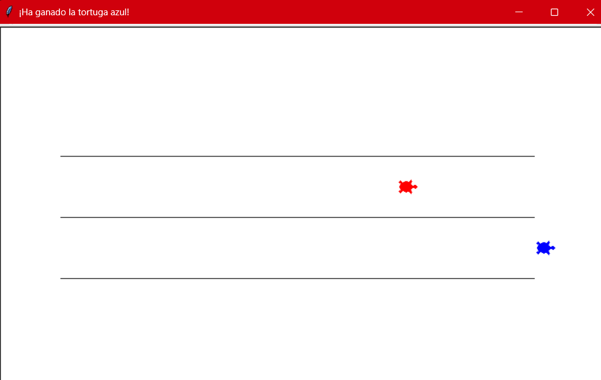
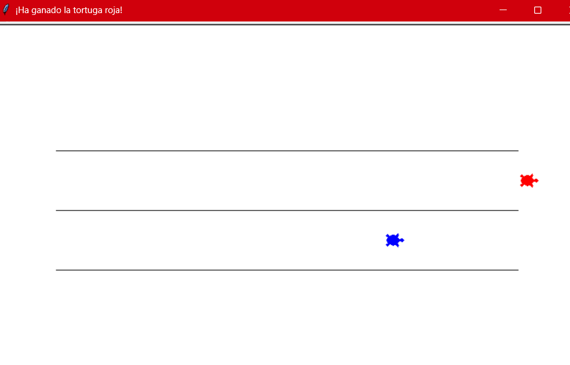
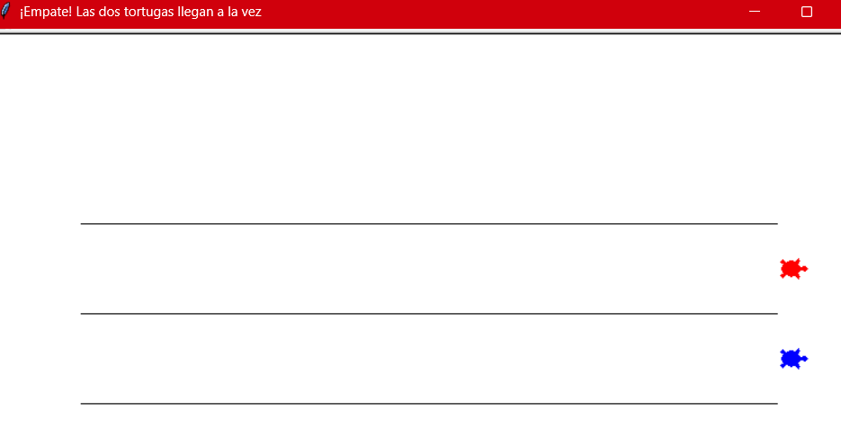
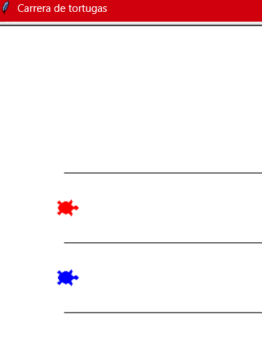

# Comprobaciones visibles de M1

Ejecuta el juego después de cada cambio y anota el resultado:

- ambas velocidades positivas: termina y anuncia una ganadora;
- roja más rápida: gana la roja;
- azul más rápida: gana la azul;
- velocidades iguales: anuncia un empate (no puede ganar siempre la roja);
- alguna velocidad igual a cero o negativa: muestra el aviso y no inicia la carrera;
- antes de ejecutar, puedes justificar tu predicción usando las velocidades.

No se considera terminado si sólo funciona con una combinación concreta.

PRUEBAS DE FUNCIONAMIENTO EN CASO DE QUE GANE AZUL:

PRUEBAS DE FUNCIONAMIENTO EN CASO DE QUE GANE ROJO:

PRUEBAS DE FUNCIONAMIENTO EN CASO DE EMPATE:

PRUEBAS DE FUNCIONAMIENTO EN CASO DE VELOCIDAD<=0:

